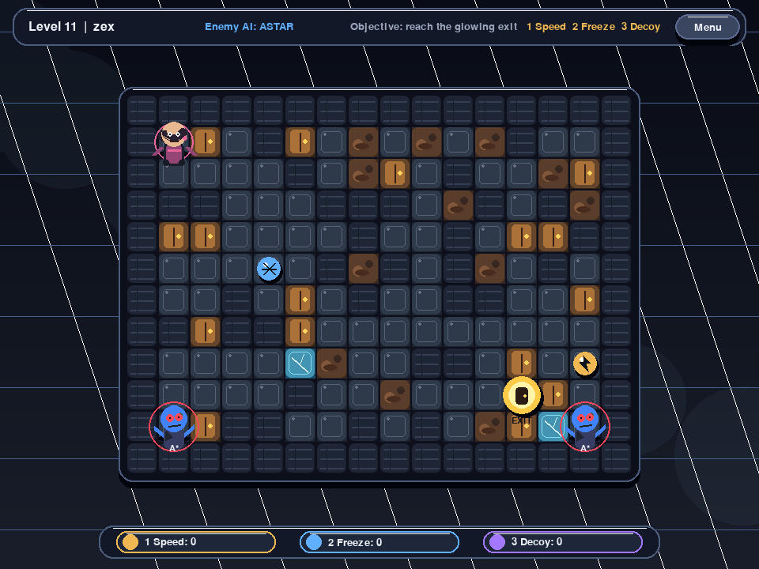
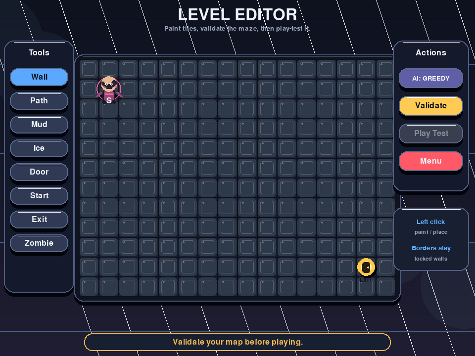

# No Way Out — Dark Cartoon Survival Edition

A tactical maze-escape game built with Pygame where you outrun zombies powered by real pathfinding algorithms. No external assets required — everything is generated at runtime.


---

## 🎮 Overview

**No Way Out** is a grid-based survival game where you navigate through increasingly complex mazes while being hunted by zombies. Each zombie family uses a different pathfinding strategy, creating a genuine AI difficulty curve that teaches search algorithms through gameplay.

- **15 handcrafted campaign levels** with progressive difficulty
- **3 enemy AI types**: Greedy, BFS, and A* pathfinding
- **5 cosmetic survivor skins** with unique visual styles
- **Built-in Level Editor** to create and play-test custom mazes
- **Runtime-generated audio** — no external sound files needed

---

## ✨ Features

### 🧠 Algorithmic Enemy AI
| Type | Color | Strategy | Difficulty |
|------|-------|----------|------------|
| **Greedy** | 🟡 Yellow | Direct chase using Manhattan distance | Easy |
| **BFS** | 🟢 Green | Shortest unweighted path | Medium |
| **A*** | 🔵 Blue | Optimal weighted pathfinding | Hard |

### 🗺️ Dynamic Tile System
- **Path** — Standard walkable tile
- **Mud** — Slows your movement by 2×
- **Ice** — Speeds up your movement by 0.5×
- **Door** — Randomly toggles open/closed, forcing path recalculation
- **Wall** — Blocks all movement

### 🎒 Power-ups
| Key | Item | Effect | Duration |
|-----|------|--------|----------|
| `1` | **Speed Boost** | 2× movement speed | 5 seconds |
| `2` | **Freeze Trap** | Zombies stop moving | 4 seconds |
| `3` | **Decoy** | Diverts zombie targeting | 5 seconds |

### 🎨 Character Skins
Five cosmetic-only survivors (no gameplay stat changes):
- **Zex** — Neon Runner (female)
- **Ninja** — Silent Shadow (male)
- **0xBP7** — Cyber Operator (male)
- **Romman** — Street Defender (male)
- **Kade** — Maze Scout (male)

---

## 🚀 Installation

### Requirements
- Python 3.8 or higher
- Pygame 2.0 or higher

### Setup
```bash
# Clone the repository
git clone https://github.com/yourusername/no-way-out.git
cd no-way-out

# Install dependencies
pip install pygame

# Run the game
python game_enhanced.py
```

> **Note:** The game uses a runtime-generated sound system. If your system has no audio device, the game will run silently without errors.

---

## 🎯 Controls

| Input | Action |
|-------|--------|
| `WASD` / `Arrow Keys` | Move player |
| `1` | Use Speed Boost |
| `2` | Use Freeze Trap |
| `3` | Use Decoy |
| `ESC` / `P` | Pause game |
| `M` | Return to Main Menu (from pause) |

### Level Editor Controls
| Input | Action |
|-------|--------|
| `Left Click` | Paint tiles / place entities |
| `Tool Buttons` | Select Wall, Path, Mud, Ice, Door, Start, Exit, or Zombie |
| `Validate` | Check map reachability |
| `Play Test` | Test your custom map |

---

## 📊 Campaign Progression

The 15-level campaign is divided into 5 difficulty tiers:

| Levels | Zombies | AI Type | Speed | Items |
|--------|---------|---------|-------|-------|
| 1–3 | 1 | Greedy | 600ms | 3 |
| 4–5 | 2 | Greedy | 600ms | 3 |
| 6–7 | 1 | BFS | 400ms | 2 |
| 8–10 | 2 | BFS | 400ms | 2 |
| 11–13 | 2 | A* | 250ms | 2 |
| 14–15 | 3 | A* | 250ms | 1 |

Progress is automatically saved to `progress.json`.

---

## 🛠️ Level Editor

Build custom mazes with the built-in editor:

1. **Paint** tiles using the left toolbar
2. **Place** the player start (`S`), exit (`E`), and up to 3 zombies (`Z`)
3. **Select** zombie AI difficulty (Greedy / BFS / A*)
4. **Validate** to ensure the exit and all zombies are reachable
5. **Play Test** to challenge your own creation

> Borders are automatically locked as walls to prevent invalid edge cases.

---

## 🏗️ Technical Architecture

### Pathfinding Implementation
- **A\*** — Uses `g` (cost from start), `h` (heuristic), and `f = g + h` with weighted tile costs
- **BFS** — Standard breadth-first search for shortest unweighted path
- **Greedy** — Pure heuristic-driven search (Manhattan distance only)

### Performance Optimizations
- **Path caching** with revision tracking — zombies only recalculate routes when the map changes (doors toggle, decoy deployed, or freeze ends)
- **Lazy recalculation** — Path updates are deferred until the zombie's next move tick
- **Safe pocket generation** — Campaign maps guarantee small safe zones around spawn points to prevent unfair instant deaths

### Audio System
The `SoundManager` class generates waveforms at runtime using the `array` and `math` modules, producing:
- Click, step, wall-hit, item pickup, power-up, win, and lose sounds
- No external `.wav` or `.mp3` files required

---

## 📝 File Structure

```
no-way-out/
├── game_enhanced.py      # Main game file (single-file architecture)
├── progress.json         # Auto-generated save file
└── README.md             # This file
```

---

## 🖼️ Screenshots

*Add your own screenshots here*

```markdown



```

---

## 🤝 Contributing

Contributions are welcome! Areas for improvement:
- Additional campaign levels
- New tile types (teleporters, traps, fog of war)
- New zombie AI variants (Dijkstra, DFS, iterative deepening)
- Sound effect variety
- Mobile/touch controls

---

## 📜 License

This project is open source. Feel free to use, modify, and distribute.

---

## 🙏 Acknowledgments

Built with [Pygame](https://www.pygame.org/) — the classic Python game framework.

**Escape the maze. Outsmart the algorithms. Find your way out.**
