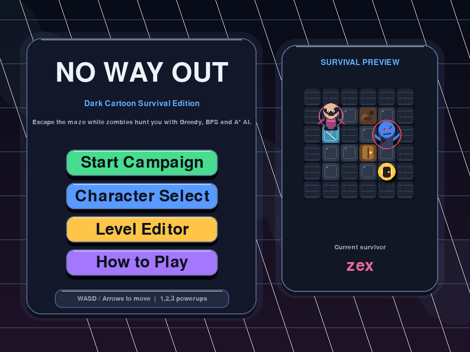

# No Way Out

**No Way Out** is a grid-based maze survival game built with Python and Pygame. Reach the exit while zombies pursue you using different pathfinding algorithms. The game is implemented in one Python file and draws its graphics and generates its sound effects at runtime; it does not need external game assets.

## Screenshots

| Main menu | Campaign gameplay | Level editor |
| --- | --- | --- |
|  |  |  |

## Features

- **15 campaign levels.** Each run uses a randomly generated maze with a configured number of walls, special tiles, zombies, and items. Completing levels unlocks the next level.
- **Three zombie pathfinding strategies.**
  - **Greedy:** follows the Manhattan-distance heuristic; it does not guarantee a shortest route.
  - **BFS:** finds a shortest route by number of steps and does not account for different tile costs.
  - **A\*:** searches using movement costs for each tile type.
- **Five cosmetic survivor skins.** Zex, Ninja, 0xBP7, Romman, and Kade do not change gameplay stats.
- **Changing terrain.** Walls block movement; Mud slows the player, Ice speeds the player up, and doors periodically toggle between passable and blocked.
- **Three power-ups.** Speed Boost doubles player speed for 5 seconds, Freeze Trap stops zombies for 4 seconds, and Decoy attracts zombies for 5 seconds.
- **Custom level editor.** Paint terrain, place the start, exit, and up to three zombies, validate reachability, and play-test the maze.
- **Generated audio.** Sound effects are synthesized at runtime. The game can also run without an audio device.

The game window is 960 x 720 pixels and the maze grid is 16 columns by 12 rows.

## Requirements

- Python 3
- Pygame

There is no dependency or packaging manifest in this repository; Pygame is the only third-party Python package imported by the game.

## Install and run

```bash
git clone https://github.com/kirollos-maged/No-Way-Out.git
cd No-Way-Out
python -m pip install pygame
python game_enhanced.py
```

On Windows, if `python` is not the Python 3 launcher on your system, use `py -3` in its place:

```powershell
py -3 -m pip install pygame
py -3 game_enhanced.py
```

Run the game from the project directory. Campaign progress is stored in `progress.json` in the current working directory when a newly unlocked level is completed.

## Controls

| Input | Action |
| --- | --- |
| `W`, `A`, `S`, `D` or arrow keys | Move |
| `1` | Use Speed Boost |
| `2` | Use Freeze Trap |
| `3` | Use Decoy |
| `Esc` or `P` | Pause or resume |
| `M` (while paused) | Return to the main menu |

## Campaign progression

Zombie movement intervals are measured in milliseconds. A shorter interval means zombies move more frequently.

| Levels | Zombies | Algorithm | Move interval | Power-ups |
| --- | ---: | --- | ---: | ---: |
| 1-3 | 1 | Greedy | 600 ms | 3 |
| 4-5 | 2 | Greedy | 600 ms | 3 |
| 6-7 | 1 | BFS | 400 ms | 2 |
| 8-10 | 2 | BFS | 400 ms | 2 |
| 11-13 | 2 | A* | 250 ms | 2 |
| 14-15 | 3 | A* | 250 ms | 1 |

The game starts with level 1 unlocked. Completing the currently highest unlocked level saves progress and unlocks the next level.

## Tiles and pathfinding

The pathfinding costs used by A\* are:

| Tile | A\* movement cost | Player movement |
| --- | ---: | --- |
| Path | 1 | Normal |
| Mud | 3 | Takes twice as long to enter |
| Ice | 0.5 | Takes half as long to enter |
| Door | 1 while open | Blocks movement while closed |
| Wall | Not traversable | Blocks movement |

A door tile is selected at random and toggled every 800 ms. BFS chooses paths by step count, while A\* uses the costs above. The Greedy strategy uses Manhattan distance to choose its route and does not factor in tile costs.

## Level editor

Select a tool from the left panel, then click a tile to paint terrain or place a start, exit, or zombie. Choose the zombie algorithm on the right, select **Validate**, and then **Play Test**. Validation checks that the exit and each placed zombie can be reached from the player start. The editor supports up to three zombies.

The outermost cells cannot be painted. The editor starts with an open grid, so add walls as needed when building a maze.

## Project files

```text
No-Way-Out/
├── game_enhanced.py       # Game, campaign, AI, editor, graphics, and audio
├── progress.json          # Created at runtime when campaign progress advances
├── screenshots/
│   ├── menu.png
│   ├── gameplay.png
│   └── editor.png
└── README.md
```

## License

This repository does not currently include a `LICENSE` file. No license terms are stated here.
